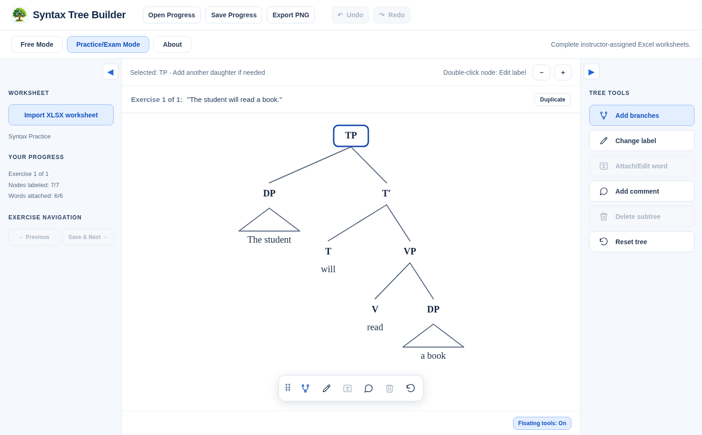

# Syntax Tree Builder

A web-based syntax tree editor for linguistics teaching. Developed by Timur Akishev (KIMEP University), 2026.



The application has two workspaces: **Free Mode** for building trees from scratch, and **Practice/Exam Mode** for working through instructor-provided Excel exercises.

## Use the application

Open the published GitHub Pages link in a desktop browser. No login or installation is required. The app processes worksheets and progress files in the browser; it does not upload students' work to a server.

### Free Mode

Select the root and use **Change label** to choose a phrase category. Build the tree using **Add branches**, select another node to label it, and use **Attach/Edit word** on terminal heads. Phrase nodes can contain triangles for unanalyzed spans. **Add comment** creates draggable notes in the canvas. You can export the tree as a PNG.

### Practice/Exam Mode

Choose **Import XLSX worksheet**. The first worksheet must have `Text` in cell A1, followed by one sentence or phrase per row in column A. The workbook can contain up to 200 exercises.

Each exercise has its own tree. Use **Previous**, **Save & Next**, or **Save and Go to** to navigate. **Duplicate** makes an independent copy of the current exercise, with labels such as `3b` and `3c`.

The tree editor tracks which worksheet words have been assigned to terminal heads or triangular phrases. Already-used words are not offered to another head. Empty heads cannot attach a word when all worksheet words are assigned; previously attached words and triangles can still be edited or removed.

Use **Save Progress** to download a `.stb.json` file, and **Open Progress** to reopen it later. Files use the desktop Syntax Tree Builder's `syntax-tree-builder-work-1` format.

## Editing controls

- Select a node with one click. Double-click to open its label menu.
- Add branches to phrase and X-bar nodes (up to three daughters for phrases and two for X-bar projections).
- Add a triangle to a phrase without daughters; edit its text through **Attach/Edit word**. Clear its text to remove it.
- Attach words to heads; edit or detach them with the same control.
- Drag comments to move them; double-click to edit, or clear the text to delete.
- Use **Undo** and **Redo** or `Ctrl/Cmd+Z` and `Ctrl+Y` / `Ctrl/Cmd+Shift+Z`.
- Zoom with the magnifier buttons or `Ctrl` + mouse wheel, and drag empty canvas space to pan.
- Collapse either side panel and drag the floating Tree Tools bar to dock it at an edge.
- Export the current tree as a high-resolution PNG.

## Publish on GitHub Pages

This repository is a static website. No installation, server configuration, build service, or package downloads are needed.

1. Create a public GitHub repository, for example `syntax-tree-builder-web`.
2. Upload the **contents of this folder** to the root of the repository, preserving the `assets`, `examples`, and `tests` folders. Do **not** upload the ZIP as a single file.
3. In the repository, open **Settings → Pages**.
4. Under **Build and deployment**, choose **Deploy from a branch**, select **main** and **/(root)**, then save.
5. Your app will be available at `https://YOUR-USERNAME.github.io/syntax-tree-builder-web/` after Pages publishes it.

To link it from your academic website, add that address to your `/apps/` page.

Alternatively, place the web app's files in a directory such as `apps/syntax-tree-builder/` inside the source repository for your main GitHub Pages site. Keep the relative file structure unchanged.

## Run locally

The separately provided **Local Preview HTML** is self-contained and can be opened directly by double-clicking it.

For this repository's multi-file source version, use a local HTTP server. For example, if Python is installed:

```bash
python -m http.server 8000
```

Then open `http://localhost:8000/`. This is needed because modern browsers restrict loading JavaScript modules directly from `file://` URLs.

## Compatibility notes

The web version follows the desktop editor's category set, branching constraints, word-index rules, triangle rules, exercise numbering, and progress-file structure. As with any Qt-to-browser port, there can be small differences in text metrics, menus, window behavior, and file dialogs. Compare critical classroom workflows with your desktop reference before using it for assessed work.

A browser cannot always overwrite a previously opened local file. In browsers that support the File System Access API, **Save Progress** can write back to a selected file. In other browsers, saving downloads a new `.stb.json` copy. Keep the latest downloaded file and reopen it when continuing your work. Free Mode retains the original limitation: it supports PNG export, not editable `.stb.json` saves.

The app does not grade the grammatical accuracy of a syntax tree or enforce secure exam conditions.

## Files

- `index.html` — page layout
- `styles.css` — interface styling
- `app.js` — tree editor and interface behavior
- `model.js` — syntactic categories and tree data model
- `xlsx.js` — Excel worksheet importer
- `assets/SyntaxTreeBuilder.png` — application icon
- `examples/worksheet_template.xlsx` — sample instructor worksheet
- `tests/model.test.mjs` — model regression tests

Run the tests with Node.js:

```bash
npm test
```

No npm packages are required.

## Rights

© 2026 Timur Akishev. The application is provided for educational, non-commercial use. No open-source license has been specified for the source code.
